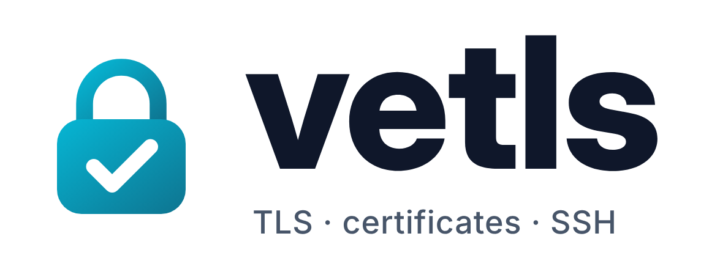
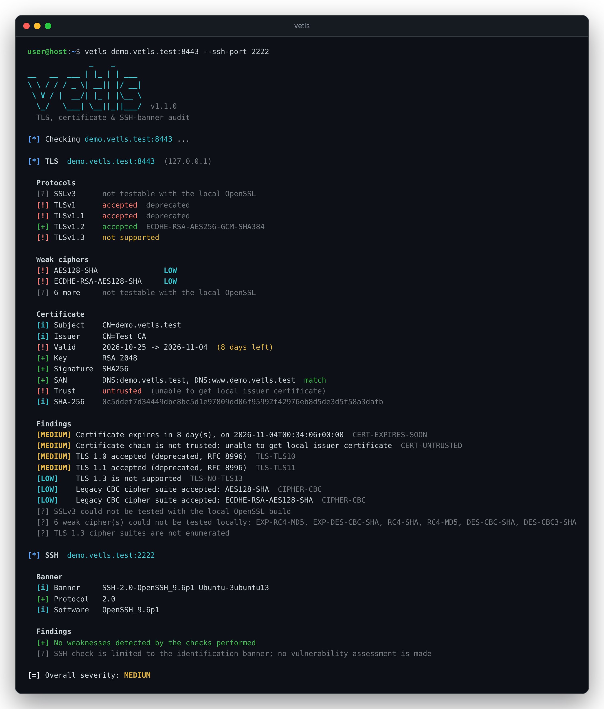

<p align="center">
  <a href="https://github.com/versex-arch/vetls">
    <picture>
      <source media="(prefers-color-scheme: dark)" srcset="docs/images/logo-dark.png">
      
    </picture>
  </a>
  <br>
  <span>Проверка протоколов TLS, слабых шифров, сертификатов и SSH-баннеров ваших серверов, ничего на них не меняя</span>
  <br>
</p>

<p align="center">
  <a href="#установка">Установка</a>
  &nbsp;&nbsp;&nbsp;•&nbsp;&nbsp;&nbsp;
  <a href="#использование">Использование</a>
  &nbsp;&nbsp;&nbsp;•&nbsp;&nbsp;&nbsp;
  <a href="docs/usage.ru.md">Документация</a>
  &nbsp;&nbsp;&nbsp;•&nbsp;&nbsp;&nbsp;
  <a href="CONTRIBUTING.md">Участие</a>
  &nbsp;&nbsp;&nbsp;•&nbsp;&nbsp;&nbsp;
  <a href="README.md">English</a>
</p>

<p align="center">
  <a href="https://github.com/versex-arch/vetls/actions/workflows/ci.yml"></a>
  
  <a href="LICENSE"></a>
</p>

<p align="center">
  <a href="docs/images/demo.png"></a>
</p>

## Установка

| Способ | Примечание |
|---|---|
| `pipx install vetls` | вместо `pipx` подойдут `pip` или `uv tool install` |
| `pip install git+https://github.com/versex-arch/vetls` | последняя версия из репозитория |
| `git clone https://github.com/versex-arch/vetls && cd vetls && pip install .` | из исходников |

Нужен Python 3.10+. Зависимости (`cryptography`, `idna`) ставятся автоматически.

> [!NOTE]
> Проверки SSLv3, RC4, DES и export-шифров зависят от **локального OpenSSL**. В большинстве современных систем они
> выключены при сборке; тогда vetls пишет «не проверяется здесь», а не «сервер отказал».

## Использование

**Проверить сервер**
```console
vetls example.com
```

**Несколько серверов или список из файла**
```console
vetls example.com mail.example.com:993
vetls -f targets.txt
```

**Один бэкенд за балансировщиком**
```console
vetls 10.0.0.5 --sni api.example.com
```

**Дополнительно прочитать баннер SSH**
```console
vetls example.com --ssh
```

**В CI: JSON + SARIF, падать на HIGH и выше**
```console
vetls -f targets.txt --fail-on HIGH --out report.json --sarif report.sarif
```

Метки в терминале: `[*]` ход проверки, `[+]` всё в порядке, `[!]` проблема, `[?]` не проверялось, `[i]` информация,
`[=]` итог.

| Код возврата | Значение |
|---|---|
| `0` | нет находок уровня `--fail-on` и выше, все проверки прошли |
| `1` | есть находка уровня `--fail-on` (по умолчанию `MEDIUM`) или выше |
| `2` | проверка не удалась (хост недоступен, на порту нет TLS) или неверные аргументы |

Все опции, уровни серьёзности, ID правил, форматы JSON и SARIF, использование как библиотеки и ограничения описаны в
**[docs/usage.ru.md](docs/usage.ru.md)**. Полный `--help` есть в [английском README](README.md#usage).

## Что проверяется

| | |
|---|---|
| 🔒 **Протоколы** | SSLv3 · TLS 1.0 · 1.1 · 1.2 · 1.3, отсутствие TLS 1.3 |
| 🧩 **Шифры** | export, анонимные, NULL, RC4, DES, 3DES, устаревшие CBC, без forward secrecy |
| 📜 **Сертификат** | истёк / скоро истекает, слабый ключ, подпись MD5 / SHA-1, самоподписанный, срок больше лимита CA/B Forum |
| 🔗 **Доверие и имя** | цепочка по системному хранилищу или `--ca-file`, SAN / wildcard / IP, IDNA 2008 |
| 🖥️ **SSH** | баннер, устаревший протокол 1.x |

## Дисклеймер

```
vetls предназначена для проверки систем, которые принадлежат
вам или на проверку которых у вас есть явное письменное
разрешение. Она выполняет обычные TLS-рукопожатия и читает
публичные баннеры: ничего не эксплуатирует, не форсирует
даунгрейд и не подбирает пароли. Сканирование чужих систем
без разрешения может быть незаконным или нарушать условия
провайдера. Автор не несёт ответственности за неправомерное
использование.
```

## Лицензия

MIT © [versex-arch](https://github.com/versex-arch). См. [LICENSE](LICENSE) и [SECURITY.md](SECURITY.md).
